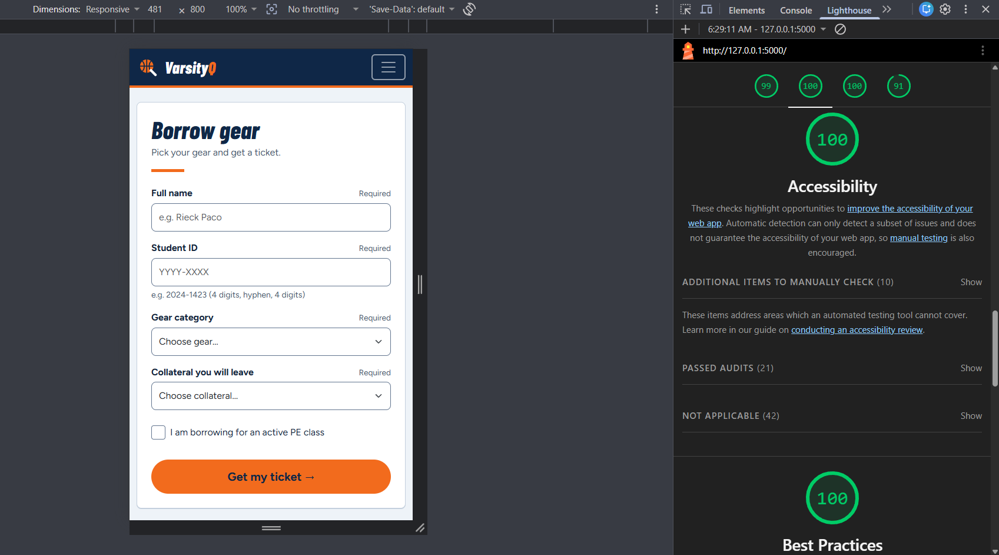
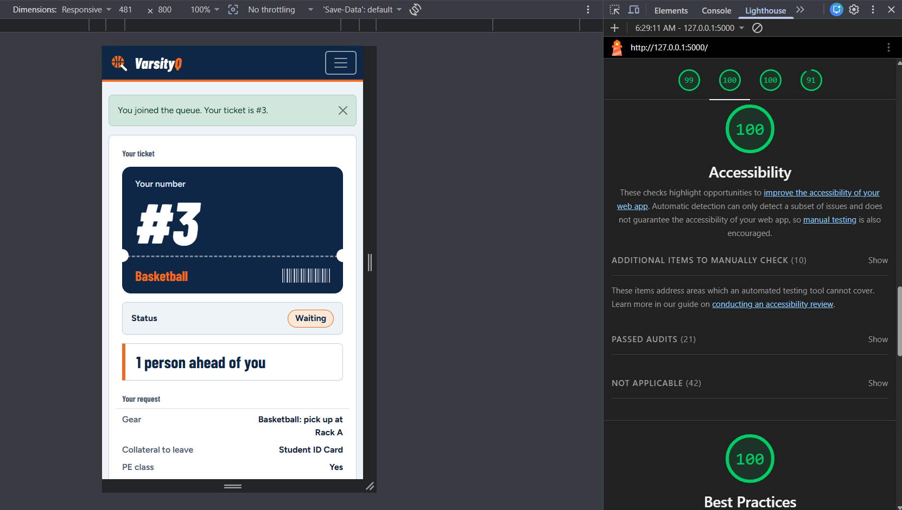
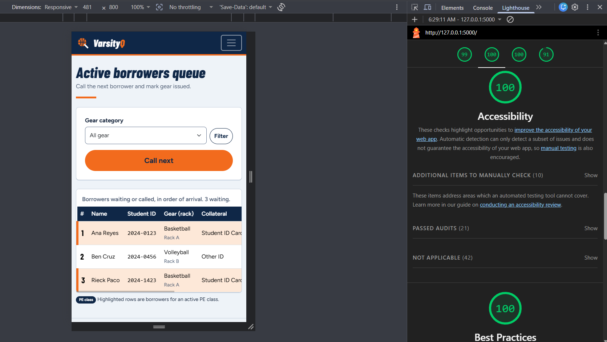

# Accessibility check for VarsityQ

I checked the three screens of the final design: Join (`/join`), My place (`/queue/<number>`) and Staff dashboard (`/staff`). I used Lighthouse, the keyboard only, and a manual checklist.

## 9a. Lighthouse (Mobile, Accessibility)

| Screen | Route | Score | Result |
| :--- | :--- | :---: | :---: |
| Join | `/join` |  | Pass ✅ |
| My place | `/queue/[number]` |  | Pass ✅ |
| Staff dashboard | `/staff` |  | Pass ✅ |

### What I fixed
- **Keyboard focus:** the custom buttons had no visible focus outline. I added a blue outline for every link, button, input and select, and a light orange one on the dark navigation bar.
- **Staff table:** it scrolls sideways on a phone, but a keyboard user could not reach it. I made it focusable and gave it a label.
- **Tap targets:** the nav links, the menu button and the PE checkbox row were shorter than 44 px, so I set a minimum height of 2.75 rem.
- **Student ID:** the field asked for the numeric keypad, which has no hyphen on an iPhone. I removed that setting so students can type `2024-1423`.

## 9b. Keyboard-only test

I used only Tab, Shift+Tab, Enter, Space and the arrow keys.

1. **Home:** the first Tab shows the "Skip to main content" link: ✅. Tab reaches **Join the queue**, and Enter opens the form: ✅.
2. **Join:** focus moves through Full name, Student ID, Gear category, Collateral, the PE class checkbox and Get my ticket in a sensible order: ✅. The dropdowns work with the arrow keys and the checkbox with Space: ✅. Error messages are linked to their fields with `aria-describedby`.
3. **Staff dashboard:** I reached the gear filter, Filter, Call next, and the Issued and No-show buttons: ✅. Each row button has a label that names its ticket, for example "Mark ticket 3 as issued".
4. **Focus visible at every step:** ✅

What failed and how I fixed it: Nothing failed

## 9c. Manual checklist

| Check | Join | My place | Staff |
| :--- | :---: | :---: | :---: |
| Every input has a visible label | ✅ | N/A | ✅ |
| Error messages say what to do, in text | ✅ | N/A | ✅ |
| Status is shown in words, not only color | N/A | ✅ | ✅ |
| Readable at 375 px with no sideways page scroll | ✅ | ✅ | ✅ |
| Buttons are at least about 44 × 44 px on a phone | ✅ | ✅ | ✅ |
| One `<h1>` and headings in order | ✅ | ✅ | ✅ |
| `<html lang="en">` is set | ✅ | ✅ | ✅ |
| Text contrast is at least 4.5:1 | ✅ | ✅ | ✅ |

Fixes made from the checklist: No fixes needed

