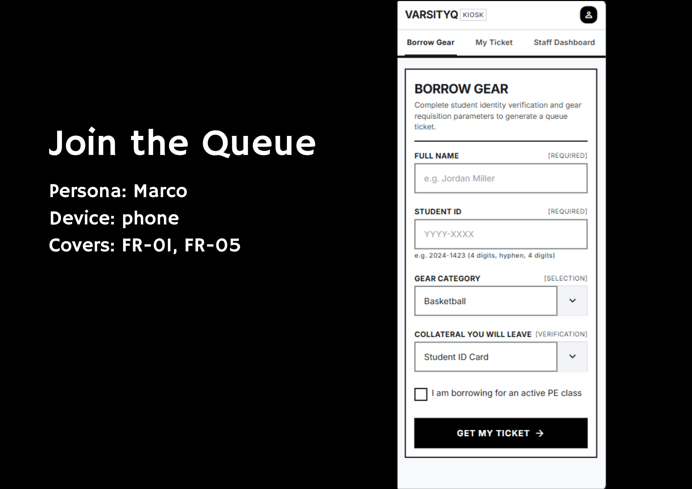
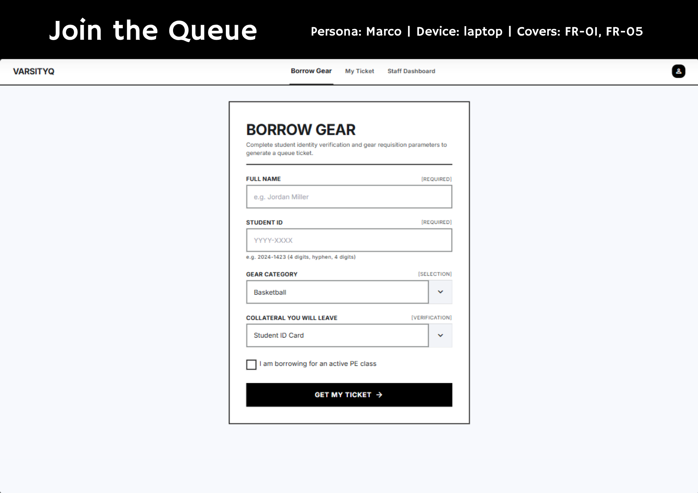
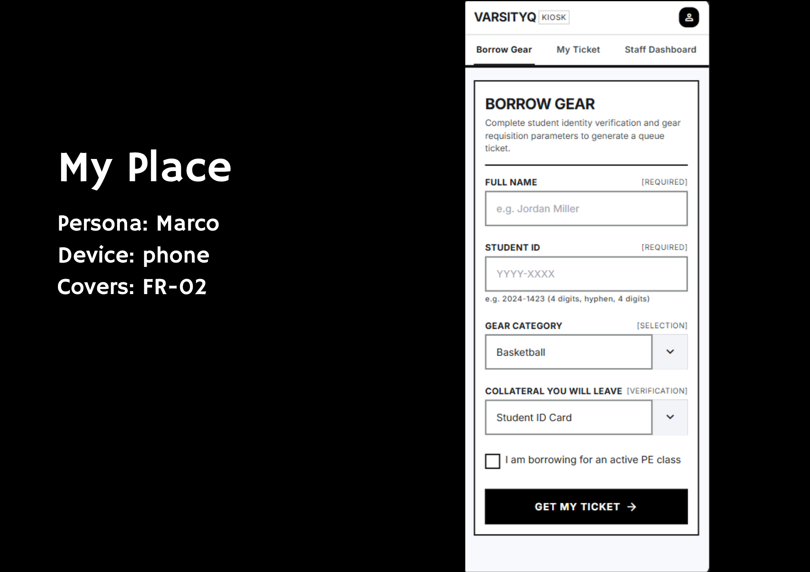
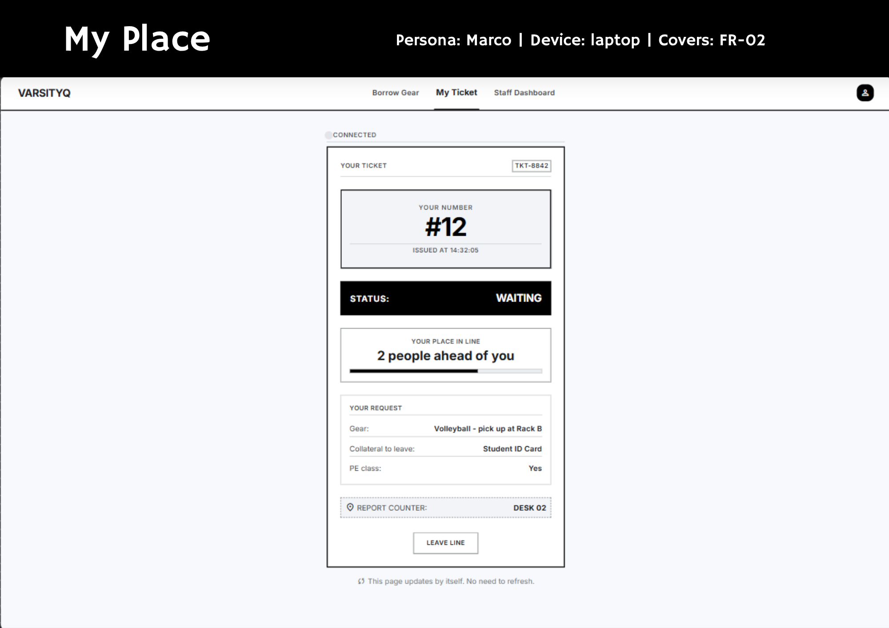
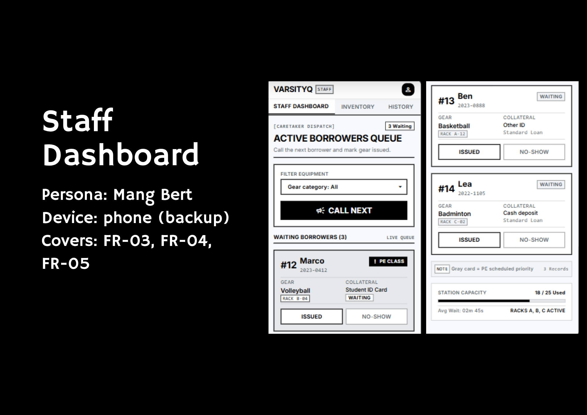
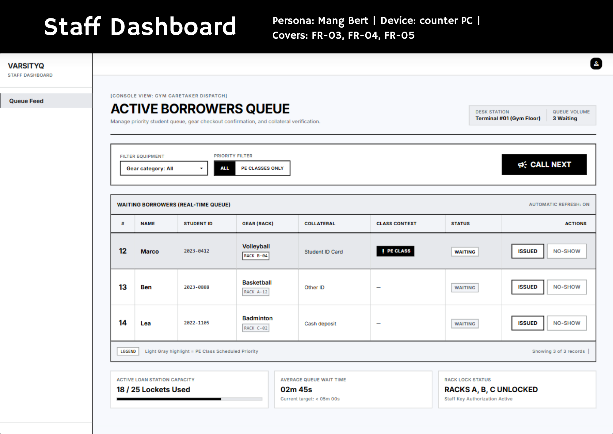
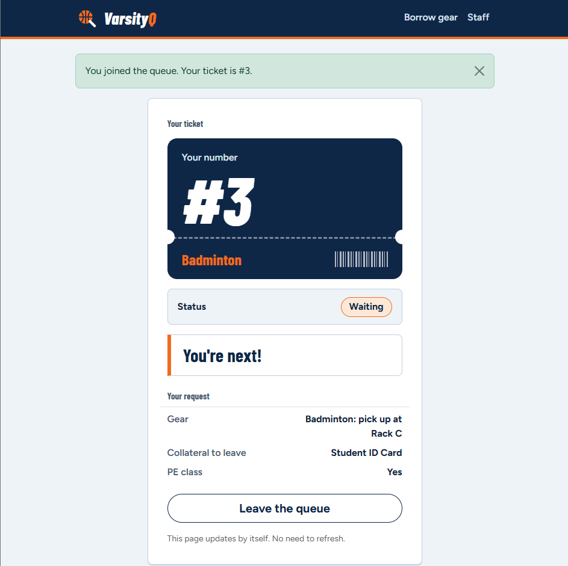
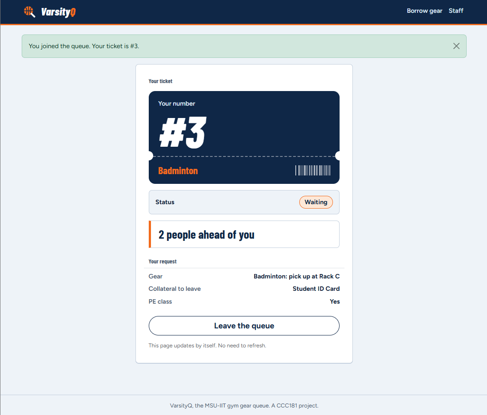

# VarsityQ: Week 3 report

## 1. Title details

- **App:** VarsityQ, a queue system for borrowing sports gear
- **Setting:** The MSU-IIT gym counter
- **Name:** Joexua Ross Rieck L. Paco
- **Student ID:** 2024-1423
- **Section:** BSCS-CS3B
- **Date:** October 26, 2026
- **Pull request:** (#1)

## 2. Personas

**Marco, the PE student and intramural athlete (person waiting).** "We wasted 20 minutes of our 1-hour PE class waiting at the desk just to find out all the volleyballs were taken, so we ended up doing basic drills instead." His top tasks are joining the queue (FR-01), checking his place (FR-02) and saying he is borrowing for a PE class (FR-05).

**Mang Bert, the campus gym caretaker (staff member).** "When PE classes start at the top of the hour, dozens of students crowd the PE office door all at once shouting gear requests and dumping their IDs on my desk." His top tasks are viewing the queue with rack locations (FR-03), calling the next borrower and marking gear issued or no-show (FR-04), and checking PE class highlights and collateral (FR-05).

Full personas: [personas.md](personas.md)

## 3. Screens

**Join.** Marco uses it to get a ticket. It covers FR-01 and FR-05.

**My place.** Marco uses it to see his number, status and how many people are ahead. It covers FR-02, and it shows the PE class answer from FR-05.

**Staff dashboard.** Mang Bert uses it to call the next borrower and mark gear issued or no-show. It covers FR-03, FR-04 and FR-05.

## 4. Design decisions

1. **The ticket number is the biggest thing on My place, inside a ticket stub, with the status and position right under it.** Marco checks his phone with one hand while walking in sun glare, so the three facts he needs must be readable at a glance. This follows the first design rule in his persona.
2. **"Call next" is the largest button, at the top of the staff dashboard, and Issued and No-show only appear on a ticket that has been called.** Mang Bert handles a rush in a 10-minute gap, so the action he uses most must be the easiest to find. My self-review also showed that staff could mark someone issued before calling them, so I hid those buttons until a ticket is called.
3. **The two dropdowns on the Join form start on "Choose gear…" and "Choose collateral…".** My self-review found that a rushed student could submit with Basketball and Student ID Card already selected and get the wrong record. Making them choose prevents that mistake.

## 5. Self-review

My review of the wireframes ([feedback.md](feedback.md)) found these problems, and I changed the following:

- **Default dropdown values** could cause a wrong submission, so both dropdowns now require a choice.
- **Only the "waiting" state was shown on My place.** I built a different message and badge for waiting, called, served and no-show.
- **NO-SHOW looked weaker than ISSUED** and both appeared on every row. They now have the same size, and they only appear on a called ticket.
- **Extra features in the generated wireframes** (a TKT code, a PE-only filter, an SMS alert, an inventory tab, summary boxes) are not in my requirements, so I did not build them.
- **Navigation was different on each frame**, so I used one navigation bar on every screen.

## 6. Accessibility

Lighthouse accessibility scores on mobile: Join 100, My place 100, Staff dashboard 100. Details and screenshots: [accessibility.md](accessibility.md).

The most important issue I fixed: when I pressed Tab, the focus moved through the text fields and dropdowns, but nothing showed which field I was on. Bootstrap removes the outline on focused form fields with a more specific rule than mine, so my style never applied. I added a 3 px blue outline for keyboard focus on every field and button. Lighthouse did not catch this, but my keyboard test did.

## 7. Usability test

I tested with Nash, a 3rd-year IT student [add how he relates to the app]. Full notes: [usability-test.md](usability-test.md).

| Task | Finished | Time | Result |
| --- | --- | --- | --- |
| 1. Get in line for Badminton | Yes | about 25 s | Submitted cleanly and landed on ticket #3 |
| 2. How many people are ahead? What is your number? | Yes, with confusion | about 15 s | Read "You're next!" and asked why, since two borrowers had joined before him |
| 3. As staff, call the next person and mark them issued | Yes | about 35 s | Call next called #1 and #2 before him |

**The one improvement.** My place counted only people waiting for the same gear, so it said "You're next!" while two others were still ahead in the staff queue. I added a `people_ahead()` function that counts everyone waiting who arrived earlier, and used it in both the page and the 10-second refresh.

| Before | After |
| --- | --- |
|  |  |

## 8. Reflection

The hardest part for me this week was catching and fixing a confusing queue bug during usability testing. I was watching my tester sign up for Badminton, and their screen immediately said "You're next!"—even though two other students were already waiting in line ahead of them on the staff view. I had to fix the code behind people_ahead() so it counted everyone waiting in order of arrival, regardless of what gear they wanted, so students wouldn't walk up to the counter too early.

It was also a reality check trying to make the app easy for everyone to use. I had to fix small details I missed at first, like changing the input field so iPhone users could actually type the hyphen in their Student ID (2024-1423), making sure keyboard users could navigate the table, and making the buttons big and clear for gym staff working under bright lights. It taught me to focus on removing actual frustration for real users instead of just making pages look fancy.

**What I will change when the data moves to a database in Week 4:**

- Tickets will survive a server restart, so the sample data in Python lists goes away.
- `people_ahead()` becomes a database count, and I will check it still matches the order staff call people.
- I will stop the same student ID from joining the queue twice, which the app does not check now.
- I will let staff call PE class borrowers first, because my current design only highlights them.
- I will add a staff login, since `/staff` is open to anyone.

## 9. Declaration

- I used Claude, an AI assistant developed by Anthropic, to support my ideas of this project. Specifically, Claude helped draft user personas based on my descriptions of physical queueing mechanisms, such as gear and paddle stacking and assisted in preparing template structures for the usability test and report documentation. It also helped me with writing, styling, and debugging CSS layout components and client-side JavaScript auto-refresh logic, as well as drafting the initial self-review section.