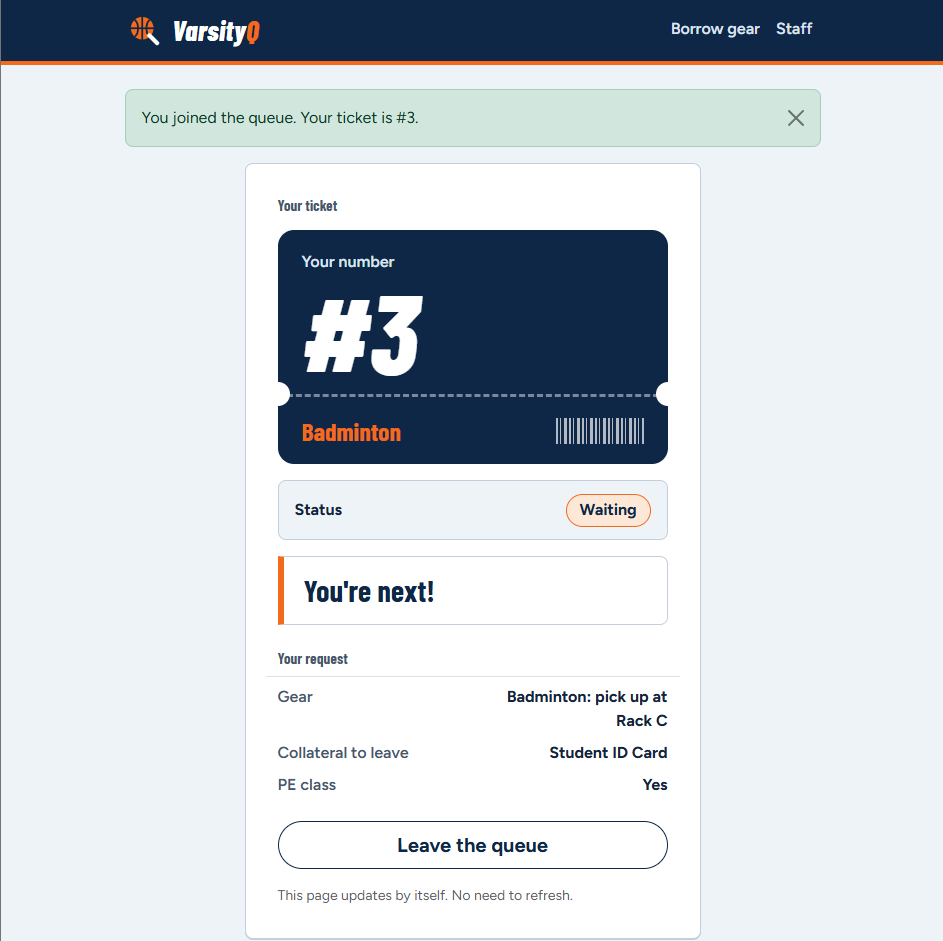
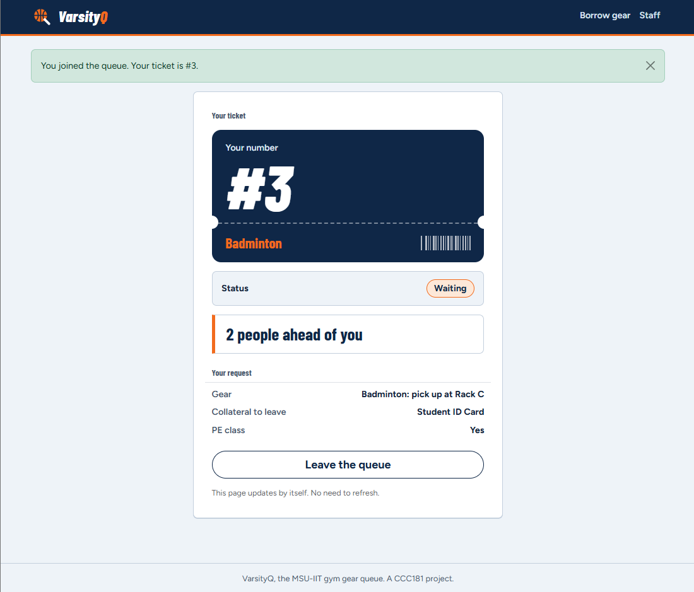

# Usability test

## Participant & Setup

- **Participant:** Nash (3rd-year IT student)
- **Persona match:** Marco (student borrower needing quick checkout) & Mang Bert (gym staff handling queues)
**Date and place:** October 26, 2026 (in-person at the gym counter)
- **Device:** Laptop browser window set to mobile width (375px) for the student ticket view, and a second laptop browser window for the staff dashboard (`/staff`).
- **Permission:** I asked permission before taking notes. I did not record their face or full name.
- **Rule:** I did not help. I asked them to think aloud.

## Task 1: Get in line for Badminton
- **Finished:** yes
- **Time:** ~25 seconds
- **What I saw:** Tester submitted the form with ID 2024-1422 for Badminton (PE class) and left their Student ID Card as collateral. The form submitted cleanly and redirected to ticket #3.
- **Persona rules:** Held: "Because Marco is in a hurry between classes, my interface must have a clear 1-click submit flow."

## Task 2: How many people are ahead? What is your number?
- **Finished:** yes (with confusion)
- **Time:** ~15 seconds
- **What I saw:** Tester opened ticket #3 and read the headline "You're next!". Tester remarked: "Wait, why does it say I'm next if Ana and Ben joined right before me?"
- **Persona rules:** Did not hold: "Because Marco wants real-time status updates, my interface must display an accurate queue position." The page reported "You're next!" even though 2 people were ahead in arrival order.

## Task 3: As staff, call the next person and mark them as served
- **Finished:** yes
- **Time:** ~35 seconds
- **What I saw:** On `/staff`, clicking "Call next" called Ticket #1 (Ana Reyes) first, then Ticket #2 (Ben Cruz), and finally Ticket #3 (Nash). The student who was told "You're next!" actually had to wait through two prior calls.
- **Persona rules:** Held for staff: Actions work sequentially by arrival. Failed for student: Status screen gave premature turn indication.

## Most serious problem

## Most serious problem
During the test, Nash saw that My place and the staff dashboard disagreed. (Nash, Ticket #3) who joined for Badminton was told "You're next!" on their ticket screen because nobody else was waiting for Badminton. However, "Call next" on "All gear" calls people strictly in order of arrival (Ana #1 for Basketball, then Ben #2 for Volleyball). Nash saw "You're next!" and asked out loud why they were listed as next when two others had not been called yet. A student who thinks they are next walks to the counter too early, creating counter crowding—the exact issue our personas wanted to prevent—and breaks the accurate position promise of FR-02.

## Improvement
- **Problem:** My place counted only the people waiting for the same gear, so it said "You're next!" while others were still ahead in the main staff queue.
- **Fix:** I added a `people_ahead()` function in `app.py` that counts everyone still waiting who arrived earlier (regardless of gear type), and used it in both the My place page and the `status.json` route, so the initial page render and 10-second auto-refresh give the exact same position count.

- **Before:** 
*Before: ticket #3 (Badminton) says "You're next!" while tickets #1 (Basketball) and #2 (Volleyball) are still waiting, so the student is told their turn has come two calls too early.*
- **After:** 
*After: the same ticket says "2 people ahead of you". The count now includes everyone who is waiting and arrived earlier, so it matches the order in which staff press Call next. It drops to "1 person ahead" and then "You're next!" as #1 and #2 are called.*