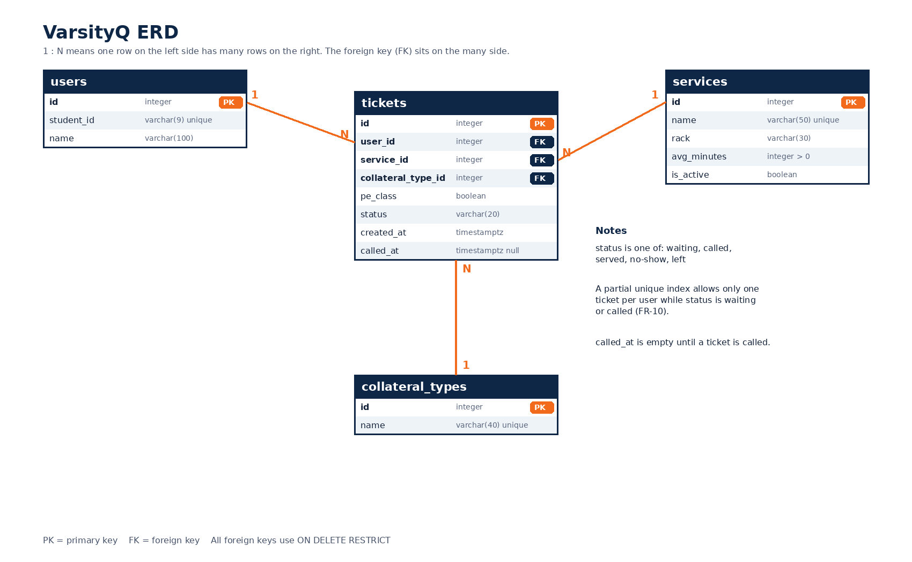

# VarsityQ schema design

This is the plan for the VarsityQ database, written before any code. The Week 3 app kept everything in Python lists. This schema moves that data into four related PostgreSQL tables.

## 2a. Nouns in my requirements

Only requirements with **Stores data? = Yes** are listed. **Bold** words are nouns.

| Req ID | Requirement | Nouns | Table or column? |
| --- | --- | --- | --- |
| FR-01 | A **student** can join the **queue** for a **sports gear category** by entering their full **name** and **Student ID**. | student, queue, gear category, name, Student ID | users, *(not a table)*, services, users.name, users.student_id. Joining also creates one new row in tickets. |
| FR-02 | A student can view their **ticket number**, current **status**, and the exact **count** of waiting borrowers ahead of them in **arrival order**. | ticket number, status, count ahead, arrival order | tickets.id, tickets.status, *(computed)*, tickets.created_at |
| FR-03 | A gym **caretaker** can view all waiting and called **tickets** in **arrival order** along with each gear item's **rack location**. | caretaker, tickets, arrival order, rack location | *(staff are not stored this week)*, tickets, tickets.created_at, services.rack |
| FR-04 | A gym caretaker can **call** the next waiting borrower in **arrival order**. | next borrower, arrival order | tickets.status, tickets.called_at, tickets.created_at |
| FR-05 ★ | A student can indicate whether they are borrowing for a scheduled **PE class** when joining the queue. | PE class | tickets.pe_class (it changes every visit) |
| FR-06 ★ | A student can select which **collateral** item they will leave at the gym counter when joining the queue. | collateral item | collateral_types, tickets.collateral_type_id |
| FR-07 | A gym caretaker can mark a called ticket as **issued**. | issued | tickets.status = 'served' |
| FR-08 | A gym caretaker can mark a called ticket as **no-show**. | no-show | tickets.status = 'no-show' |
| FR-09 | A student can **leave** the queue and cancel their ticket while its status is waiting. | leave, cancel | tickets.status = 'left' |
| FR-10 ★ | A student with an **active** waiting or called ticket cannot submit a **second ticket** using the same Student ID. | active ticket, Student ID | users.student_id (UNIQUE), and a partial unique index on tickets.user_id |
| FR-11 | A gym caretaker can add a new **gear category** with its **rack location** and **average issue time**. | gear category, rack location, average issue time | services, services.rack, services.avg_minutes |
| FR-12 | A gym caretaker can edit an existing gear category's name, rack location, average issue time, and **active status**. | active status | services.is_active |
| FR-13 | A gym caretaker can **delete** a gear category that has **no tickets** attached to it. | delete, tickets attached | foreign key tickets.service_id with ON DELETE RESTRICT |
| FR-14 ★ | A gym caretaker can **filter** the staff queue view by gear category. | filter, gear category | tickets.service_id (used in a WHERE) |
| FR-15 ★ | A gym caretaker can record when issued gear is **returned** and collateral is **released**. | returned, released | *(later)* a new column tickets.returned_at, added by a migration |
| FR-16 | A gym caretaker can **log in** with a **password**. | login, password | *(later)* a staff login: a role and password hash in users, or a staff table |
| FR-17 | A gym caretaker can view a **daily summary** of issued gear, no-shows and early departures per gear category. | daily summary | *(computed)* a GROUP BY on tickets, no new table |

Two rules from the lecture, and how I follow them:

- **The queue is not a table.** It is all tickets with status `waiting` for one gear category, ordered by `created_at` (with `id` to break a tie).
- **Store facts, not results.** I store *when* a ticket was created. The position in line, "2 people ahead of you", is computed with a query, so I never have to rewrite many rows when someone joins or leaves.

## 2b. Tables and columns

| Table | Columns |
| --- | --- |
| `users` | id, student_id, name |
| `services` | id, name, rack, avg_minutes, is_active |
| `collateral_types` | id, name |
| `tickets` | id, user_id, service_id, collateral_type_id, pe_class, status, created_at, called_at |

Where each Week 3 field went. For each one I asked: *is it a fact about the person, the service, or this one visit?*

| Week 3 field | Fact about | Goes in |
| --- | --- | --- |
| Full name | the person | `users.name` |
| Student ID | the person | `users.student_id` |
| Gear category | the service | `services`, linked from `tickets.service_id` |
| Rack location | the service | `services.rack` |
| Collateral | this visit (it can differ each time) | `collateral_types`, linked from `tickets.collateral_type_id` |
| PE class | this visit (a student borrows for PE one day and for intramurals another) | `tickets.pe_class` |
| Status, ticket number | this visit | `tickets.status`, `tickets.id` |

Choices I made on purpose:

- **Collateral is its own small table** and not a text column. The gym could add a new kind of collateral, and then a row is added and no code or constraint has to change. A label that is renamed only changes in one place.
- **No staff table this week.** No requirement I am building needs to know *which* caretaker acted. FR-16 (login) is marked Later, and it will add a role and a password hash through a migration.
- **The status word is `served`** in the database, and the screens show "Issued". Week 3 already worked this way.
- **A new status `left`** replaces what Week 3 saved as `no-show` when a student cancelled. Leaving and not showing up are different facts, and the FR-17 summary needs to tell them apart.

## 2c. Types and constraints, one row per column

| Table | Column | PostgreSQL type | Constraint | Why |
| --- | --- | --- | --- | --- |
| users | id | integer, generated always as identity | PRIMARY KEY | Generated by the database, never reused |
| users | student_id | varchar(9) | NOT NULL, UNIQUE, CHECK (student_id ~ '^[0-9]{4}-[0-9]{4}$') | One record per student, and the MSU-IIT format of 4 digits, a hyphen, 4 digits is enforced by the database |
| users | name | varchar(100) | NOT NULL, CHECK (length(trim(name)) > 0) | A ticket needs a name the caretaker can call, so blank names are rejected |
| services | id | integer, generated always as identity | PRIMARY KEY | Generated by the database |
| services | name | varchar(50) | NOT NULL, UNIQUE | Two gear categories cannot share a name |
| services | rack | varchar(30) | NOT NULL | The caretaker needs the storage location (FR-03) |
| services | avg_minutes | integer | NOT NULL, CHECK (avg_minutes > 0) | Rejects impossible values |
| services | is_active | boolean | NOT NULL, DEFAULT true | A category can be switched off without deleting its history (FR-12) |
| collateral_types | id | integer, generated always as identity | PRIMARY KEY | Generated by the database |
| collateral_types | name | varchar(40) | NOT NULL, UNIQUE | No duplicate collateral names |
| tickets | id | integer, generated always as identity | PRIMARY KEY | The ticket number. It is generated by the database, so two borrowers can never get the same number (NFR-02) |
| tickets | user_id | integer | NOT NULL, REFERENCES users(id) ON DELETE RESTRICT | No ticket for a missing student |
| tickets | service_id | integer | NOT NULL, REFERENCES services(id) ON DELETE RESTRICT | No ticket for a missing gear category |
| tickets | collateral_type_id | integer | NOT NULL, REFERENCES collateral_types(id) ON DELETE RESTRICT | No ticket with an unknown collateral |
| tickets | pe_class | boolean | NOT NULL, DEFAULT false | Unchecked means false (FR-05) |
| tickets | status | varchar(20) | NOT NULL, DEFAULT 'waiting', CHECK (status IN ('waiting', 'called', 'served', 'no-show', 'left')) | Only these five states exist |
| tickets | created_at | timestamptz | NOT NULL, DEFAULT now() | Time zone safe and set by the database. It gives the arrival order |
| tickets | called_at | timestamptz | CHECK (called_at IS NULL OR called_at >= created_at) | Empty until the ticket is called, and it can never be earlier than arrival |
| tickets | user_id (index) | partial unique index | UNIQUE (user_id) WHERE status IN ('waiting', 'called') | FR-10 and NFR-02: a student can have only one active ticket, even if two requests arrive in the same second |

Constraint coverage: **PRIMARY KEY** (every table), **FOREIGN KEY** (three on tickets), **NOT NULL**, **UNIQUE** (student_id, service name, collateral name, and the partial index), **CHECK** (student ID format, name, average minutes, status, called_at), and **timestamptz** (created_at, called_at).

`called_at` is the only column that is allowed to be empty, on purpose: a ticket that has not been called has no calling time.

## 2d. ERD

The same diagram as text is in [erd.dbml](erd.dbml).

Relationships, read aloud:

- One user has many tickets. Each ticket belongs to exactly one user. (**1 : N**)
- One service has many tickets. Each ticket is for exactly one service. (**1 : N**)
- One collateral type has many tickets. Each ticket names exactly one collateral type. (**1 : N**)

The foreign key always sits on the "many" side, which is `tickets`. There is no many-to-many relationship, so there is no join table.

What happens when a parent row is deleted:

| Foreign key | Rule | Reason |
| --- | --- | --- |
| tickets.user_id | RESTRICT | Tickets are the gym's history. Deleting a student must not erase their past borrowing. |
| tickets.service_id | RESTRICT | A gear category that has tickets cannot be deleted. This is exactly FR-13, which only allows deleting a category with no tickets. To stop using a category, staff switch off `is_active`. |
| tickets.collateral_type_id | RESTRICT | Old tickets must still show what collateral was left. |

## 2e. Normalization check

1. **One value per cell (1NF):** no column holds a list. Each ticket has one gear category, one collateral and one status.
2. **Depends on the whole key (2NF):** there are no join tables, and every table has a single-column primary key, so every other column depends on the whole key.
3. **No hidden copies (3NF):** a student's name and ID are stored once in `users`. A gear category's name and rack are stored once in `services`. A collateral label is stored once in `collateral_types`. Tickets hold only facts about one visit. If a rack moves or a name changes, exactly one row is updated.

Nothing stores a result that can be computed: there is no position column and no "number of people waiting" column.

## Decisions I am still open about

- **Name changes:** a student who joins again with a different spelling of their name keeps the name from the first visit, because the form looks the student up by Student ID.
- **Status word:** `served` in the database and "Issued" on the screens. If I rename it, I must change it in the CHECK, the code and the screens together.
